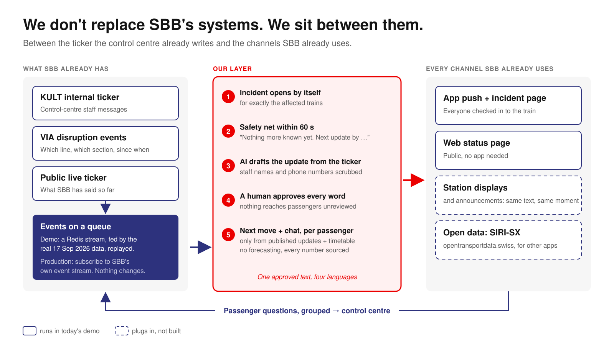
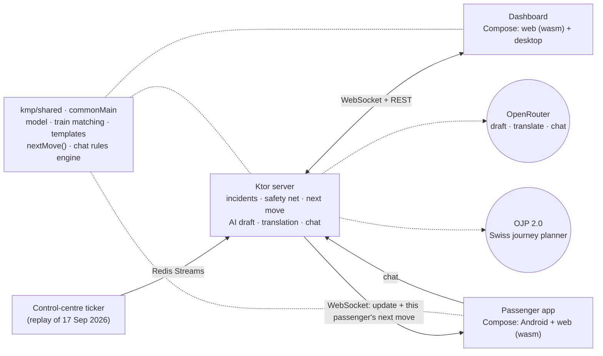
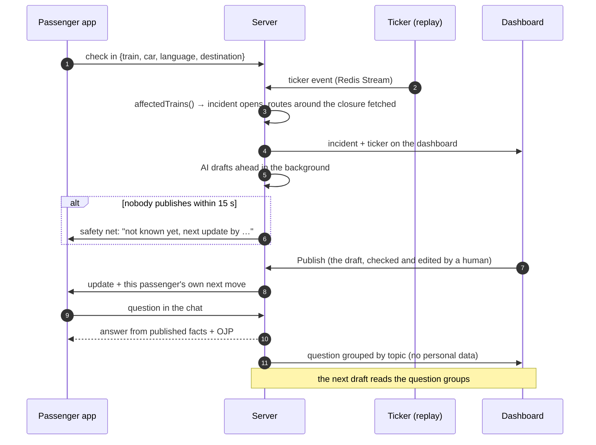

<div align="center">

# Rail Status

**A status page for trains.** When a line breaks, every passenger on an affected train hears about it within seconds, gets *their own* next move with every update, and can ask a chat that knows their trip.

LauzHack 2026 · team **bayes-boys** · SBB track *"Turn disruption data into the best next move"* + JetBrains track *Kotlin Multiplatform*


**[The problem](#the-problem)** · **[What we built](#what-we-built)** · **[The pitch](#the-pitch)** · **[How it works](#how-it-works)** · **[How we built it](#how-we-built-it)** · **[Run it](#run-it-yourself)** · **[Docs](#documentation)**

</div>

---

> [!NOTE]
> This is my ([@abi-azan](https://github.com/abi-azan), Albert) copy of the project we built as a team of four at LauzHack 2026 in Lausanne (21–22 Nov 2026). It's forked from the team's public copy, [`bayes-boys/lauzhack-2026-public`](https://github.com/bayes-boys/lauzhack-2026-public), with the write-ups below added. The code is the team's. SBB's challenge data, the sponsors' material and all API keys are not in this repo ([details](#whats-not-in-this-repo)).

## At a glance

| | |
|---|---|
| **15 s instead of 95 min** | Replaying SBB's real data from 17 Sep 2026, passengers on board got their first message after 15 seconds. That evening, SBB's first public travel advice took 95 minutes. |
| **1 codebase, 5 binaries** | A Ktor server, the passenger app on Android and in the browser, and the control-room dashboard on the web and the desktop. All Kotlin, in one Gradle build. |
| **94 % shared** | The passenger app is 94 % common code, the dashboard 98.5 %. Only Bluetooth, the foreground service and notifications are written per platform. |
| **AI drafts, a human decides** | A [Koog](https://docs.koog.ai) agent turns the control centre's internal shorthand into a four-language update. Nothing reaches a passenger until an operator clicks Publish. |
| **Computed, not generated** | The "next move" on a passenger's phone is plain logic on SBB's published facts and the real journey planner. No model writes it. |
| **4 people, 4 AI agents, ~28 hours** | Each of us drove our own Claude Code agent on the same repo. The agents coordinated on a GitHub issue used as a message board: 316 posts, 260 commits, 221 tests. |

## The problem

On **17 September 2026 at 17:22**, a fire on the overhead line between Renens VD and Allaman stopped trains near Lausanne. Thousands of passengers sat in stopped trains with one question: *what do I do now?*

| After the fire | What passengers got that evening |
|---:|---|
| 0 min | Nothing. The control centre starts logging, in internal shorthand, mostly French. |
| **95 min** | SBB's first public travel advice. |
| **160 min** | The replacement-bus notice. |

Nobody was being careless. At first nobody knew what had happened, not even the staff. The control centre was writing everything down, but in a form no passenger can read, and nobody had time to rewrite it.

SBB gave us that evening's real data: the VIA event log, the internal KULT ticker and the public live ticker. Our demo replays it.

## What we built

A status page for trains, built into a look-alike of **SBB Mobile**, the app Swiss passengers already use. We only changed the places where SBB Mobile already talks about disruptions: the notification, a yellow band on top of every tab, and the "Information" page.

| | |
|---|---|
| **Check-in without a tap** | Each car has a Bluetooth beacon that sends its name. While the screen is on, the app listens every ~20 s, takes the strongest signal, and checks the passenger in to that train and car. It sends only the train, the car, the language and the destination: no name, no login. A QR code in the car works too, and "Not on this train?" undoes a wrong check-in. Someone still on the platform can follow their departure instead. |
| **Nobody is left alone** | Control-centre messages open an incident by themselves for exactly the affected trains. If nobody publishes within 15 seconds (60 s outside the demo), every passenger on board gets an honest "nothing more is known yet, next update by HH:MM". |
| **The AI drafts, a human decides** | In the dashboard, an AI turns the internal ticker into a passenger update in German, French, Italian and English. Staff names, phone numbers and IDs are scrubbed before anything leaves the server, and the draft is checked again on the way out. It drafts ahead, so the text is usually ready when the operator clicks. The operator edits in English, and the edit is translated at publish. |
| **A next move for each passenger** | Every update reaches each checked-in phone instantly, with advice for *that* passenger: stay on board for now, the backup route from the live Swiss journey planner (OJP), and the last moment to decide. Once SBB confirms replacement buses, SBB's own advice comes first. Our suggestion and SBB's official word are never mixed. |
| **A chat that knows the trip** | Passengers ask in any language. A model (Claude Sonnet via OpenRouter) answers from what SBB published for their train, plus real connections from OJP, and it's told never to invent a time. Every question is also grouped for the control room ("Other ways to travel: 12"), and the next AI draft reads those groups, so the next update answers what people are actually asking. |

### The demo, end to end

This is the flow we had to be able to click through ourselves, and the one we showed on stage:

1. **Phone:** check in to IR 90 1734 (beacon or QR).
2. **Dashboard:** send the first messages from 17 Sep.
3. **Phone** buzzes: "not known yet, next update by …" (the safety net, after 15 s, with nobody in the control room having typed a word).
4. **Dashboard:** the AI draft is already in the publish dialog. The operator checks it and publishes.
5. **Phone** updates and shows the passenger's next move.
6. **Passenger** asks the chat.
7. **Dashboard:** the question shows up, grouped, under Passenger questions.
8. The **next update** answers it.
9. **Resolved.**

`./demo test` runs all nine steps headlessly against a running server.

### Where it fits

We don't replace anything at SBB. Rail Status sits between the ticker the control centre already writes and the channels SBB already uses.

<p align="center"></p>

Station displays and SIRI-SX open data are marked "plugs in, not built": that's where it would connect, and we didn't build them. Details: [`docs/pitch/integration-fit.md`](docs/pitch/integration-fit.md).

## The pitch

We gave three pitches: the LauzHack main jury (3 min), JetBrains (4 min) and SBB (about 6 min). **All three were live demos with no slides.** The judges were meant to see the product working, not a picture of it.

- **SBB:** three judges each held one of our phones, each a different passenger on the evening of 17 September: one going to Lausanne with a Supersaver ticket, one going on to Sion, one still waiting on the platform. One operator sent SBB's real disruption from the dashboard in four beats, and the judges watched their own phones react. The opening line had no hook, just: *"We took an already existing product and made it even more user friendly."*
- **JetBrains:** four Compose Multiplatform screens side by side (Android phone, the same app in a browser, the dashboard on the web and on the desktop). One click on Publish, the same update on all four.
- **Main jury:** the whole story in three minutes on one mirrored phone and the dashboard.

The moment the SBB pitch was built around is **15 seconds of silence**: the incident opens on the projector, nobody touches anything, and then three phones in the judges' hands buzz at once.

**The full write-up, with the cast, the four beats, the scene-by-scene run of each pitch, the "don't claim" lists and the fallbacks: [`docs/PITCH.md`](docs/PITCH.md).**

## How it works



One incident, start to finish:



### The stack

| Part | Built with | What it does |
|---|---|---|
| [`kmp/shared`](sbb-prototype/kmp/shared) | Kotlin Multiplatform (JVM + wasm) | The data model and API types, `affectedTrains()`, the update templates, **`nextMove()`**, and the chat's rules engine (ported from TypeScript and checked against 2,940 golden answers from the old one) |
| [`kmp/agent`](sbb-prototype/kmp/agent/README.md) | [Koog](https://docs.koog.ai) 1.3 | The AI draft as an agent with **six read-only tools**, all our own functions: ticker events, affected trains, published updates, next move, routes around the closure, passenger question groups |
| [`kmp/server`](sbb-prototype/kmp/README.md) | Ktor, Lettuce (Redis Streams) | Ticker → incident → publish → fan-out; check-ins; the safety net; the draft desk; translation; the chat; serves both web builds from one origin |
| [`kmp/admin`](sbb-prototype/kmp/admin) | Compose Multiplatform (wasm + desktop) | The control-room dashboard: incidents, ticker, the AI-first publish dialog, passenger questions, the "Live demo" bar |
| [`native/`](sbb-prototype/native/README.md) | Compose Multiplatform (Android + wasm) | The passenger app, matched to SBB Mobile screen by screen: passive beacon check-in, the live notification, the Information page, the next-move card, the chat |
| [`kmp/replayer`](sbb-prototype/kmp/replayer/replay.py) | Python | Replays 17 Sep from SBB's data into the ticker stream, in four curated beats |
| `./demo`, `kmp/scripts`, `kmp/ops` | Bash, Node, systemd | One command to start, test and run the demo; a self-healing install with a watchdog; the headless 9-step smoke test |

### Design decisions worth knowing

- **The logic lives once, in `commonMain`.** Train matching, templates, `nextMove()` and the chat rules run identically on the server, in both dashboards and in both passenger apps, so the phone's card and the server's chat can't disagree.
- **Our suggestion never becomes SBB's word.** The next move is computed, not generated. The Koog agent can *read* it through a tool, but its prompt forbids copying it into SBB's official alternatives. On the phone it's labelled as our estimate, with its sources.
- **Every model call is optional.** Without an API key, the dashboard publishes from templates and the chat answers from the shared rules engine. If the Koog agent fails or is slow, a single model call takes over.
- **Personal data stays out of the models.** Staff names, phone numbers, e-mails, staff IDs and radio call signs are scrubbed from every ticker line before a model sees it. From the chat, the AI draft sees topics and counts, never what a passenger typed.
- **A real queue, not a demo shortcut.** The ticker arrives on Redis Streams with separate consumer groups for detection and fan-out, the same shape as subscribing to SBB's own event stream.
- **No Firebase.** On Android, a foreground service holds the WebSocket and updates one notification in place. On the web, the browser's Notification API.

The full picture, with every component, the AI pieces and their fallbacks, and the known limits: **[`docs/ARCHITECTURE.md`](docs/ARCHITECTURE.md)**. A gentler explainer with diagrams: [`docs/how-it-works.html`](docs/how-it-works.html) (open it in a browser).

## How we built it

Four people, each driving their own **Claude Code** agent, all pushing to `main` of one repo at the same time, for about 28 hours.

The agents coordinated on **GitHub issue #1, used as a message board**. Every post starts with `[agent of @login] TYPE: title`. An agent posts a CLAIM naming the files before it touches them, the owners ACK, and it posts DONE with the commit when it has pushed. One agent is the lead: it keeps the task list and makes the project-wide DECISIONs. Every human can overrule their own agent.

| | |
|---|---|
| Board posts | **316** (110 DONE · 66 replies · 33 CLAIM · 31 DECISION · 16 REQUEST · 8 PROPOSAL · …) |
| Commits | **260**, 189 of them with the Claude co-author line |
| Review findings | **37** from agents reviewing each other's parts, each with an owner and a lead OK/NAY |
| Tests | **221**, the shared ones running unchanged on the JVM and as wasm in headless Chrome |
| One real handover | a CLAIM, two ACKs (the first after 18 s) and a deployed DONE, 17 minutes end to end |

How the protocol worked, the timeline from the first commit to the pitch, and what went wrong along the way: **[`docs/HOW-WE-BUILT-IT.md`](docs/HOW-WE-BUILT-IT.md)**. The rules the agents followed are in [`CLAUDE.md`](CLAUDE.md).

### The team

| | Main areas |
|---|---|
| [**Albert**](https://github.com/abi-azan) (@abi-azan) | Team lead from Sunday 03:57, the pitches, the SBB Mobile teardown, e2e test, incident page, station follow |
| [**Emil**](https://github.com/EmilPopovic) (@EmilPopovic) | Team lead until 03:57, the server, the dashboard, the model chat, demo operations |
| [**Martin**](https://github.com/MartinVrbovcan) (@MartinVrbovcan) | Next move, OJP routes, the Koog draft agent, integration fit |
| [**Matej**](https://github.com/cappig) (@cappig) | The passenger app, notifications, the chat port to Kotlin, AI data safety |

### My part

- **Lead from Sunday 03:57.** Emil handed the lead to me (and my agent) so he could get some sleep before the pitches. From then on my agent and I kept the task list in [`ARCHITECTURE.md`](docs/ARCHITECTURE.md), settled overlapping claims and made the project-wide calls, like making every pitch a live demo.
- **The pitches.** The three screenplays and live-demo runbooks in [`docs/pitch/`](docs/pitch/), rebuilt against the actual code each time the product changed, plus the presenter role.
- **Early product work.** The teardown of the real SBB Mobile app (64 screenshots of what it shows before and during a disruption) that the look-alike was built from, the first look-alike shell, and the first support chat with its research (keyword rules vs. a model classifier).
- **Code.** The headless test of all nine demo steps (`./demo test`), the first version of the incident page, "follow a departure from the platform", and the first version of the Koog draft agent module.
- **Reviews and docs.** The review of the next-move suggestion, an evaluation of the hackathon's data sources and APIs, and the final README and architecture doc.

## Run it yourself

> [!IMPORTANT]
> The demo's replay needs SBB's challenge data, which isn't public, so in this repo the dashboard's "Live demo" bar is hidden and `./demo run` can't replay 17 September. Everything else runs: the server, both apps, incidents opened by hand from the dashboard, publishing, the next move and the chat.

The scripts target **Linux** (they use `setsid`, `systemd-inhibit` and systemd user services).

```sh
export OPENROUTER_API_KEY=...   # AI draft, translation, chat (optional: without it, templates and rules)
export OJP_KEY=...              # optional: real routes from opentransportdata.swiss OJP 2.0

./demo start     # builds on the first run; prints a public HTTPS address and a check-in QR code
./demo open      # dashboard + passenger app in the browser
./demo test      # check all 9 demo steps headlessly
./demo stop
```

After `./demo start`: the passenger app is at `<address>/`, the check-in link at `<address>/#/checkin/IR90-1734?car=7`, and the dashboard at `<address>/admin/`.

| You need | For |
|---|---|
| JDK 17 or 21 | Gradle and the server (Gradle 8.14 doesn't run on JDK 25) |
| Android SDK | The passenger app's build |
| Docker | Redis (optional: without it, an in-memory queue) |
| uv, Node 22+ | The replayer and QR code; the e2e test |
| cloudflared | The HTTPS tunnel for phones (downloaded if missing) |

For the Android app, see [`sbb-prototype/native/README.md`](sbb-prototype/native/README.md) and [`TESTING.md`](sbb-prototype/native/TESTING.md). Every server setting and endpoint is in [`sbb-prototype/kmp/README.md`](sbb-prototype/kmp/README.md).

### What's not in this repo

| Left out | Why |
|---|---|
| SBB's challenge data (`Daten/`) and the replay beats (`demo-beats.json`) | SBB's internal ticker texts, shared with hackathon teams only |
| The sponsors' briefs and slides | Sponsor material |
| The screenshots of the real SBB Mobile app | Screenshots of SBB's app; the [teardown write-up](docs/sbb-mobile-teardown/README.md) is still here |
| API keys | Bring your own |

## Documentation

| Doc | What's in it |
|---|---|
| [`docs/PITCH.md`](docs/PITCH.md) | **How the pitch worked:** three live demos, the cast, the four beats, each pitch scene by scene, the honesty rules and the fallbacks |
| [`docs/HOW-WE-BUILT-IT.md`](docs/HOW-WE-BUILT-IT.md) | **Four people, four agents:** the message-board protocol, the timeline, the review loop, what went wrong |
| [`docs/ARCHITECTURE.md`](docs/ARCHITECTURE.md) | Components, data flow, the AI pieces and fallbacks, design decisions, known limits, the final task list |
| [`docs/how-it-works.html`](docs/how-it-works.html) | A plain-language explainer with diagrams |
| [`docs/pitch/`](docs/pitch/) | The original screenplays (`screenplay-*.txt`), demo notes and pitch visuals |
| [`docs/DEMO.md`](docs/DEMO.md) | The demo runbook: setup, roles, pre-stage checklist |
| [`docs/UX-SPEC.md`](docs/UX-SPEC.md) | What the passenger sees, screen by screen |
| [`docs/sbb-mobile-teardown/`](docs/sbb-mobile-teardown/README.md) | What the real SBB Mobile shows during a disruption, and what we add |
| [`docs/review-2026-11-22.md`](docs/review-2026-11-22.md), [`review-nextmove`](docs/review-nextmove-2026-11-22.md) | The agents' code reviews and their fixes |
| [`sbb-prototype/kmp/README.md`](sbb-prototype/kmp/README.md) | Server settings, REST and WebSocket API, replayer, dashboard |
| [`sbb-prototype/native/README.md`](sbb-prototype/native/README.md) | Building the passenger app |

## Acknowledgements

Thanks to **SBB** for the challenge and for real data from a real evening, to **JetBrains** for the Kotlin Multiplatform track, and to the **LauzHack** team for the weekend. The passenger app is a hackathon look-alike of SBB Mobile, built to show how the idea would feel inside the app passengers already use; it isn't affiliated with or endorsed by SBB.
