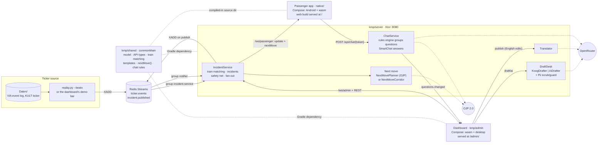
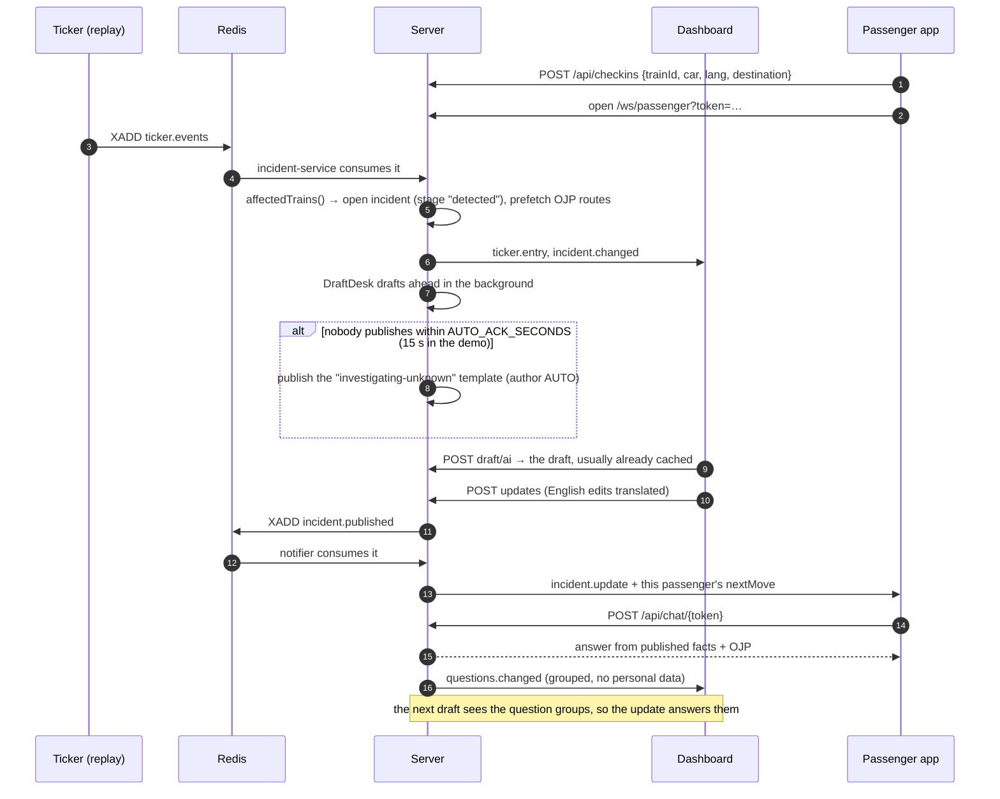

# Architecture

How Rail Status is put together, why it's built that way, and who owns what. The vision and team protocol are in [`CLAUDE.md`](../CLAUDE.md); env vars and every endpoint are in [`sbb-prototype/kmp/README.md`](../sbb-prototype/kmp/README.md). The lead (agent of @abi-azan) keeps this file current, including the task list in [§8](#8-tasks).

**Contents:** [1. The system at a glance](#1-the-system-at-a-glance) · [2. Components](#2-components) · [3. One incident, end to end](#3-one-incident-end-to-end) · [4. The AI pieces and their fallbacks](#4-the-ai-pieces-and-their-fallbacks) · [5. Design decisions](#5-design-decisions) · [6. How the demo runs](#6-how-the-demo-runs) · [7. Known limits](#7-known-limits) · [8. Tasks](#8-tasks)

## 1. The system at a glance

Three inputs, one server, two clients:

- **In:** the control centre's ticker (in the demo, `replay.py` or the dashboard's demo bar replaying 17 Sep 2026 from `Daten/`) arrives on a Redis Stream.
- **Middle:** a Kotlin/Ktor server turns ticker events into incidents, holds the check-ins, computes each passenger's next move, runs the AI draft and the chat, and fans updates out.
- **Out:** the operator's **dashboard** publishes updates; the **passenger app** (an SBB Mobile look-alike) receives them, with a next move and a chat.



## 2. Components

| Component | Tech | Responsibility | Key files |
|---|---|---|---|
| `kmp/shared` | KMP: JVM + wasmJs | The data model and all API/WebSocket types; `affectedTrains()`; filling missing languages; the 5 update templates' rendering; **`nextMove()`**; the chat's **rules engine** (ported from TypeScript, checked against 2,940 golden answers) | `model/Model.kt`, `model/Api.kt`, `model/Logic.kt`, `nextmove/NextMove.kt`, `chat/Engine.kt` |
| `kmp/agent` | KMP + Koog 1.3 | The AI draft as a **Koog agent**: 6 read-only tools (`ticker_events`, `affected_trains`, `published_updates`, `next_move`, `routes_around_closure`, `passenger_questions`), typed `DraftOutput` in 4 languages, a tool-call trace for the dashboard | `DraftAgent.kt`, `DraftTools.kt`, `DraftSources.kt` |
| `kmp/server` | Kotlin, Ktor, Lettuce | Ticker → incident → publish → fan-out; check-ins; safety net; next move per passenger; AI draft desk; translation; chat; demo control; Web Push; serves both web builds | `IncidentService.kt`, `Bus.kt`, `Routes.kt`, `DraftDesk.kt`, `KoogDrafter.kt`, `AiDrafter.kt`, `Pii.kt`, `Translator.kt`, `ChatService.kt`, `SmartChat.kt`, `NextMovePlanner.kt`, `NextMoveCorridor.kt`, `Ojp.kt`, `DemoControl.kt` |
| `kmp/admin` | Compose Multiplatform: wasm + desktop | The operator dashboard: incidents, ticker, publish (AI-first dialog), resolve, passenger questions, the "Live demo" bar. API client, store and reducer in `commonMain` | `App.kt`, `AdminStore.kt`, `AdminApi.kt`, `DemoBar.kt` |
| `native/` | Compose Multiplatform: Android + wasm | The passenger app, pixel-matched to SBB Mobile: passive beacon check-in, QR and deep link, live notification, the "Information" sheet, the next-move card, the chat sheet. ~94 % shared code | `incident/PassengerStore.kt`, `incident/PassiveCheckIn.kt`, `screens/incident/`, `screens/easyride/NextMoveCard.kt`, `ChatSheet.kt`, `androidMain/.../platform/RideService.kt` |
| `kmp/replayer/replay.py` | Python | Replays 17 Sep from `Daten/` into `ticker.events`: 35 events (7 VIA, 28 KULT), HTML stripped, phone numbers removed, clock times moved to now. `--beats` = the 4 curated demo moments | |
| `kmp/scripts`, `kmp/ops` | Bash, Node | `demo.sh` (start/stop/status), `tunnel.sh`, `e2e/smoke.mjs` (the 9 demo steps, headless); `install.sh` (systemd user services) + `watchdog.sh` | |

## 3. One incident, end to end



**Step by step:**

1. **Check-in.** The app sends the train, car, language and destination and gets a token. No account, no name. After a server reset, the app checks in again by itself.
2. **Detect.** `IncidentService` consumes `ticker.events`. `affectedTrains()` (shared) matches each event's line or section to the trains, and an incident opens at stage `detected`. Later events on the same disruption join it. With OJP on, the routes around the closure are fetched right away, so they're ready before the first update.
3. **Safety net.** If no update is published within `AUTO_ACK_SECONDS`, the server publishes the "investigating-unknown" template itself, so every passenger on board hears something. Any publish cancels the timer.
4. **Draft.** `DraftDesk` drafts ahead (2.5 s after the last ticker change), with the Koog agent or the single-call drafter, switchable live (`./demo koog on|off`). The ticker is scrubbed of personal data before it reaches the model, and the output is checked again. The operator sees an English draft, edits it, and publishes.
5. **Publish and fan out.** Publishing writes to `incident.published`. The `notifier` consumer sends each checked-in passenger on an affected train an `incident.update` over their WebSocket, with **their own** `nextMove` attached. Delivery counts and time-to-first-notification go back to the dashboard.
6. **Chat.** The passenger asks; the server answers (see §4). Every question is also classified by the shared rules engine into a topic and grouped per incident, with personal data stripped, so the dashboard shows "Other ways to travel: 12", not 12 messages.
7. **Close the loop.** The next draft reads the question groups (as topic × count, never the passengers' words), so the next update answers what people are actually asking.
8. **Resolve.** A `resolved` update closes the incident and clears its delay. A late ticker message about it still joins it; only a new `created` event opens a fresh incident.

**Stages:** `detected` → `investigating` → `identified` → `monitoring` → `resolved`. Passengers never see `detected`; `GET /api/incidents/{id}` returns 404 until the first publish.

## 4. The AI pieces and their fallbacks

Every model call is optional: without `OPENROUTER_API_KEY` the whole demo still runs on templates and rules.

| Where | What the model does | Model (default) | If it fails or there's no key |
|---|---|---|---|
| **Draft** (`DraftDesk`) | Ticker → stage, title, body, cause, alternatives in DE/FR/IT/EN. Koog agent with 6 tools, or one call with the same context | `openai/gpt-6-luna` (`DRAFT_MODEL`) | Koog → the single call; no key → the operator picks one of the 5 templates |
| **Translate** (`Translator`) | The operator's English edit → DE/FR/IT at publish | same as the draft | English in the other languages; never the stale draft |
| **Chat answer** (`SmartChat`) | Answers the actual question from the trip, the published updates and our suggestion; plans journeys with OJP (any trip through the closed section is marked not possible); replies in the passenger's language | `anthropic/claude-sonnet-5.5`, backup `claude-haiku-5.5`, 40 s budget | Says plainly "Sorry, I couldn't get an answer just now"; never a rule's "not known yet". No key → the shared rules engine answers |
| **Chat grouping** | Always the shared rules engine; a classifier model only when the rules say "other" | `z-ai/glm-5.3-flash` | The rules' topic |

**Guard rails:**
- **Personal data.** `Pii.scrub` removes staff names, phone numbers, e-mails, staff IDs and radio call signs (keeping place names) from every ticker line before it reaches a model, and `AiDrafter.guard` re-checks the output. Chat questions are scrubbed before they reach the dashboard, which may be on a projector.
- **Our suggestion never becomes SBB's word.** The next move is computed by `nextMove()`, not generated. The agent can read it through a tool, but its prompt forbids copying it into the official alternatives or letting it change the stage. On the phone, the card is labelled "Estimate", with its sources.
- **A human publishes.** Nothing the AI drafts reaches a passenger until the operator clicks Publish. The only automatic message is the safety net's fixed template.

## 5. Design decisions

| Decision | Why |
|---|---|
| **Everything is Kotlin, logic in `commonMain`** | The JetBrains track, and one source of truth: train matching, templates, `nextMove()` and the chat rules run identically on the server, in both dashboards and in both passenger apps. The phone's card and the server's chat can't disagree. |
| **Redis Streams with consumer groups** (`incident-service`, `notifier`) | It's the shape of the real integration: SBB's control centre writes a ticker; we read it from a queue. Detection and fan-out are separate consumers, so they can scale or fail apart. `BUS=memory` swaps in an in-process queue for tests and laptops without Docker. |
| **State in memory** | A hackathon trade-off: incidents and check-ins live in `IncidentService`; Redis is only the queue. A restart or reset clears everything, and the app re-checks in by itself. |
| **`native/` is its own Gradle build** that compiles `kmp/shared/src/commonMain` as an extra source dir | The app stays on Kotlin 2.2.21; `kmp/` moved to 2.3.10 for Koog. Sharing *sources* keeps one model without forcing one compiler. It's also why Koog lives in `kmp/agent`, not `shared`: it would break the app's build. |
| **The Koog agent runs on the server** | The OpenRouter key never leaves the server, and the agent's tools are our own deterministic functions, read-only. |
| **Next move is computed, not generated** | Confirmed admin alternatives plus real detours (OJP, or the hand-coded corridor), with a decision deadline. No forecasting. Passengers can trust that a time on the card came from a timetable. |
| **No Firebase** | On Android, a foreground service holds the WebSocket and updates one notification in place; on the web, the browser's Notification API. No Google project, no device tokens. (The server still has Web Push endpoints; the Kotlin app doesn't use them.) |
| **One origin serves everything** | The server mounts the passenger web build at `/` and the dashboard at `/admin/` (`STATIC`), so one HTTPS tunnel covers phones, Bluetooth, notifications and `wss://`. |
| **The admin key is off by default** | Demo convenience. With `ADMIN_KEY` set, `/api/admin`, `/api/control`, `/api/ingest` and `/ws/admin` need it. |

## 6. How the demo runs

```
demo laptop
├── Redis (Docker, unless-stopped)
├── railstatus server :8080 ── serves / (passenger web) and /admin/ (dashboard)
├── cloudflared quick tunnel ── https://<random>.trycloudflare.com → :8080
├── sleep / lid-switch blocker
└── watchdog (every minute): restarts the server if /health fails, the tunnel if the address fails twice,
    and on a new address rewrites .demo/url + the QR code and posts it on the team board
```

- `./demo start` runs these detached (`scripts/demo.sh`); `./demo install` turns them into systemd user services that restart on a crash and survive a reboot.
- The demo sets `AUTO_ACK_SECONDS=15` and `TRAINS_ANCHOR=17:30`, so the 17 Sep trains run on today's clock.
- **Driving the replay:** the dashboard's "Live demo" bar sends the 4 beats from inside the server (`DemoControl`, from `demo-beats.json`), one click each, strictly in order. `./demo run` does the same from the terminal. Don't mix the two in one run. Public copies of the repo leave out `demo-beats.json` (it holds SBB's internal ticker texts), and then the bar is hidden.
- **Demo trains** (`Fixtures.kt`): `IR90-1734` Genève-Aéroport → Brig is the judges' train; `IC1-725` and `RE33-4234` also cross Lausanne – Genève; `IC8-1234` Bern → Brig is the unaffected control.
- **Phones:** `native/scripts/flash-demo-phone.sh <serial> [supersaver|ticket|ga]` installs the build, grants every permission and sets the persona. Presenting: [`DEMO.md`](DEMO.md) and [`pitch/`](pitch/).

## 7. Known limits

- **The address changes** when the quick tunnel restarts, and phones need re-pointing (T16).
- **No persistence:** a server restart loses incidents and check-ins (by design, see §5).
- **Next move without OJP** covers only Allaman – Renens VD. `./demo start` passes `OJP_KEY` through from your shell; the systemd services don't.
- **One server instance.** The consumer groups would allow more, but the state is in one process.
- **The chat needs the network** for its model answer; offline it says it can't answer rather than guessing.

## 8. Tasks

Claim on the board with the task id. The lead updates the **Owner** and **Status** columns. Last updated by the lead on 22 Nov, 11:15 UTC. Done tasks are listed below the open ones.

### Open

| Id | Task | Area | Owner | Status / done when |
|---|---|---|---|---|
| T8 | Pitch: all pitches are live demos, no slides | `docs/pitch/` | @abi-azan | Screenplays (main 3 min, JetBrains 4 min, SBB 5–6 min) and demo notes are done, rebuilt against `7f29d88`. **Open:** each rehearsed once end to end with a timer. |
| T12 | AI data safety + chat hand test | `kmp/server` | @cappig | PII scrubber and output guard are in and tested on the real 17 Sep data. **Open:** the hand test of the chat across the 4 beats, now against the model chat. |
| T16 | Stable demo address instead of a quick tunnel | `kmp/scripts`, `ops/`, Cloudflare | @EmilPopovic | Not started; the scripts already support `TUNNEL_TOKEN` + `PUBLIC_URL`. Done when the phones and QR survive a tunnel restart. |
| T19 | Review leftovers: C3 (cause from the latest reason), C6 (`{next}` filled at publish), C8 (fenced JSON) in `AiDrafter`; D10, D12 on the incident page | `AiDrafter`, `native/` incident files | @EmilPopovic | Fixed, or dropped by the lead. See [`review-2026-11-22.md`](review-2026-11-22.md). |
| T20 | JetBrains J2: JetBrains Air recording (Junie + Claude Code side by side) | `docs/pitch/` | @EmilPopovic | The recording exists, or the notes say "Claude Code in the terminal". J1, J3, J4, J6 are done. |

### Done

| Id | Task | Owner | Result |
|---|---|---|---|
| T1 | Passenger app reaches the demo flow in the SBB look | @cappig | Final demo build `f9ca0e1`: passive beacon check-in, QR, incident sheet, next-move card, chat |
| T2 | Chat ported to Kotlin: rules engine in `shared`, endpoint and grouping in `server` | @cappig | The Node `chat/` is gone |
| T3 | `nextMove()` in `shared`, attached to every `incident.update` | @MartinVrbovcan | |
| T4 | Dashboard: SBB look, demo steps 4, 7, 9; dark mode; AI-first publish dialog; demo bar | @EmilPopovic | `9d5dec0`, `c119bed`, `c829766` |
| T5 | Android notifications: foreground service + self-updating notification | @cappig | |
| T6 | Demo operations: `./demo`, QR codes, self-healing services, phone flash script | @EmilPopovic, @cappig | |
| T7 | Delete legacy TypeScript and the first Android try | lead | `4ac7ee3` |
| T9 | Incident page as SBB's "Information" sheet (D1–D12, minus T19's leftovers) | @EmilPopovic, @MartinVrbovcan, @abi-azan | `d5a57e4` |
| T10 | Headless e2e smoke for the 9 demo steps | @abi-azan | `./demo test`, 9/9 live |
| T11 | Integration fit: how this plugs into SBB's systems | @MartinVrbovcan | [`pitch/integration-fit.md`](pitch/integration-fit.md) |
| T13 | Passenger at the station: follow a departure from the platform | @abi-azan | |
| T14 | Next-move routes from OJP | @MartinVrbovcan | `8d227de` |
| T15 | Sticky `delayMin`, cleared on resolve | @MartinVrbovcan | `88188d9` |
| T17 | AI draft as a Koog agent in `kmp/agent` | @MartinVrbovcan | `2129931`; on in the live demo; `./demo test` 9/9 with Koog |
| T18 | Review of the next-move suggestion; fixes #1–#5 done by owners | @abi-azan | [`review-nextmove-2026-11-22.md`](review-nextmove-2026-11-22.md) |
| T21 | Koog chat fallback | @cappig | **Superseded** by Emil's model chat (`SmartChat`, `0434747`) |
