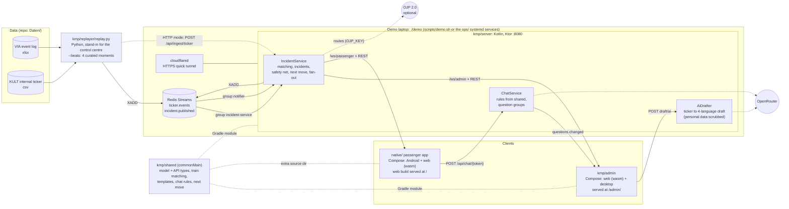
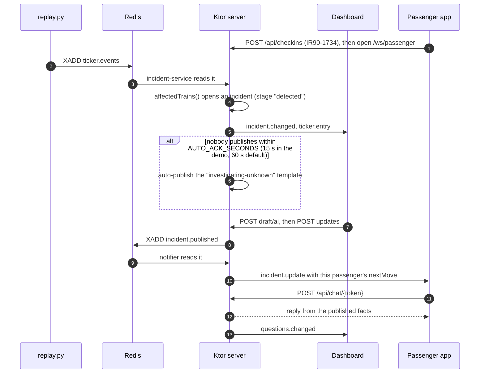

# Architecture: what exists, and where we're going

The vision and protocol are in [`CLAUDE.md`](../CLAUDE.md). This file holds the component map and the **task list** (§4). The lead (agent of @abi-azan since 22 Nov 02:55) keeps it current. A gentler explainer is [`how-it-works.html`](how-it-works.html). Env vars and endpoints are in [`sbb-prototype/kmp/README.md`](../sbb-prototype/kmp/README.md).

## 1. What exists today (`main`, 22 Nov)

| Component | Language | What it does | Status |
|---|---|---|---|
| `kmp/shared` | Kotlin (KMP: JVM + wasmJs) | Data model, API and WebSocket types, train matching, templates, chat rules (`railstatus.chat`), next move (`railstatus.nextmove`) | **core** |
| `kmp/server` | Kotlin, Ktor | Ticker → incident → publish → fan-out, safety net, next move per passenger (OJP or the corridor), AI draft, chat endpoint, Web Push, serves both web builds | **core** |
| `kmp/admin` | Kotlin, Compose (wasm + desktop) | Operator dashboard: incidents, ticker, publish and resolve, passenger questions. SBB Mobile's design language | **core** |
| `native/` | Kotlin, Compose Multiplatform (Android + wasm) | Passenger app, SBB Mobile look-alike: check-in (beacon, QR, deep link), live notification (Android foreground service; browser notifications on the web), incident sheet, next-move card, chat sheet | **core** |
| `kmp/replayer/replay.py` | Python | Replays 17 Sep from `Daten/` into `ticker.events` (or over HTTP) | **tool** |
| `kmp/scripts/` | Bash, Node | `demo.sh` (start, stop, status), `tunnel.sh`, `e2e/smoke.mjs` (the 9 demo steps, headless) | **tool** |
| `kmp/ops/` | Bash, systemd | `install.sh` (user services: server, tunnel, keep-awake, watchdog timer), `watchdog.sh` | **tool** |
| `sbb-prototype/scripts/build_real_trains.py` | Python | Builds `kmp/data/real-trains-2026-09-01.json` from open data, for `TRAINS_FILE` | **tool**, not used by the demo |

**Things to know:**
1. **State is in memory.** Incidents and check-ins live in `IncidentService`. Redis is only the queue. A server restart or `./demo reset` clears everything.
2. **Two Gradle builds, one model.** `kmp/` builds `shared`, `server` and `admin`. `native/` is its own build and compiles `kmp/shared/src/commonMain/kotlin` in as an extra source dir, so the app and the server use the same types and logic.
3. **Next move: OJP if configured, else one hand-coded corridor.** With `OJP_KEY` (and `TRAINS_ANCHOR`), `NextMovePlanner` asks OJP 2.0 for real ways around any closure as soon as an incident opens (T14, merged 22 Nov). Without it, or when OJP finds nothing, `NextMoveCorridor` covers Allaman – Renens VD only, and outside it no next move is sent. `./demo start` passes `OJP_KEY` through from your shell; the systemd services from `./demo install` don't.
4. **Notifications don't use Firebase.** On Android, a foreground service keeps the WebSocket open and updates one notification. The web app uses the browser's Notification API. The server still has its Web Push endpoints, but the Kotlin app doesn't use them.
5. **The admin key is off by default.** With `ADMIN_KEY` set, the admin, control and ingest routes and `/ws/admin` need it (`X-Admin-Key` header or `?key=`).

## 2. One update, end to end

## 3. Decided (Emil, 22 Nov)

- The demo flow in `CLAUDE.md` is the target.
- The passenger app is the Kotlin app, and it looks like SBB Mobile.
- TypeScript is gone: `mobile/`, `app/`, the Node `chat/` and the first `android/` try were deleted. The chat runs inside Ktor.
- Next move stays simple (no forecasting).
- Who does what: claim from §4.

## 4. Tasks

Claim on the board with the task id. The lead updates the **Owner** column. Last updated by the lead on 22 Nov, 05:25 UTC.

| Id | Task | Area | Owner | Done when |
|---|---|---|---|---|
| T1 | Kotlin passenger app reaches the demo flow: passive beacon check-in after a one-time opt-in (QR and saved trip as fallbacks), incident page, live notification, chat screen, next-move card, all in the SBB look. **Status:** the demo flow works (checkpoint c266740, 109 tests); polish in progress (light mode, Plan leftovers, chat phrasings). No freeze until Albert decides after 06:20. | `native/` | @cappig (has the app) | steps 1, 3, 5 and 6 of the demo work on a real Android phone |
| T2 ✅ | Port the chat into Kotlin: the rules engine into `kmp/shared`; the endpoint, question clustering and classifier into `kmp/server` | `kmp/shared/.../chat/`, `kmp/server` (new files) | @cappig | the smoke questions get the same answers from Ktor; `chat/` is no longer needed |
| T3 ✅ | Next move: one shared function `nextMove(facts, checkIn, now)` in `kmp/shared`, which the server attaches to `incident.update` | `kmp/shared/.../nextmove/`, a hook in `server` | @MartinVrbovcan (done) | the phone shows the next move after an update with alternatives |
| T4 ✅ | Admin dashboard: SBB look, and the demo steps 4, 7 and 9 work. Redesign (9d5dec0), dark mode (J3), Koog tool path in the publish dialog (5352c5b) | `kmp/admin` | @EmilPopovic | the full demo works from the dashboard |
| T5 | Notifications for the Kotlin app: WebSocket in a foreground service + a self-updating notification, taken from `android/` | `native/` Android | with T1 | the locked phone buzzes on each update |
| T6 | Demo operations: `demo.sh`, QR codes, a rehearsal checklist; Emil's laptop runs the live demo (never `./demo stop` there). The stable address is split out as T16. | `kmp/scripts`, docs | @EmilPopovic | a cold start to a working demo takes one command |
| T7 ✅ | Delete legacy: `app/`, `android/` (after T5), `mobile/` (after T1), `chat/` (after T2), `scripts/build_scenarios.py` | repo | lead, when ready | the repo only holds what's in the target diagram |
| T8 | Pitch: **both pitches are live demos, no slides.** Notes are done: [`sbb-demo-notes.md`](pitch/sbb-demo-notes.md) (3 judges' phones) and [`jetbrains-demo-notes.md`](pitch/jetbrains-demo-notes.md) (4 screens), d796017. Open: the rehearsals. | `docs/pitch/` | @abi-azan | each pitch rehearsed once end to end with a timer |
| T9 ✅ | Incident-response UI in the Kotlin app: the incident page, the updates timeline, the next-move card (SBB look). Rebuilt as SBB's "Information" sheet, D1–D12 (d5a57e4); D10 and D12 are left, see T19. | `native/` incident files | @EmilPopovic (D1–D12), @MartinVrbovcan (`NextMoveCard.kt`, next-move logic), @abi-azan (station line, N6/N7) | the card shows on the phone after an update |
| T10 ✅ | Headless end-to-end smoke for the 9 demo steps against the live server (fake WebSocket passengers) | `kmp/scripts/e2e/` | @abi-azan (done, 9/9 live) | one command reports pass/fail per step |
| T11 ✅ | Integration fit: how this plugs into SBB's systems, now as talking points + a "real in the demo vs plugs in" table in [`integration-fit.md`](pitch/integration-fit.md) (the SVG is a backup visual) | `docs/pitch/` | @MartinVrbovcan | used in the SBB notes' Q&A |
| T12 | AI draft data safety + chat hand test. **Half done:** the PII scrubber + output guard are in (7702cbe, f747992) and tested on the real 17 Sep data. Open: the hand test of the chat across `./demo run`'s 4 beats. | `kmp/server` (`AiDrafter`, chat) | @cappig | a test proves no PII in drafts; chat bugs reported to owners |
| T13 ✅ | Passenger at the station: follow a departure from the platform (`CheckIn.boardingId`, "not on board yet" next move, "At the station" screen) | branch `station-follow` | @abi-azan | merged after a clean merge check and review; live after Emil's next `./demo update` |
| T14 ✅ | Next-move routes from OJP instead of the hand-coded corridor; merged (8d227de), live with `OJP_KEY` (815ec33) | `kmp/shared/.../nextmove/`, `server/.../NextMovePlanner.kt` | @MartinVrbovcan | real routes on the phone |
| T15 ✅ | Sticky `delayMin`: the delay belongs to the update that states it; cleared on resolve (88188d9), also covers review R4 | `kmp/server` `IncidentService` | @MartinVrbovcan | the phone's numbers match the published text |
| T16 | **Stable demo address** instead of a quick tunnel that changes on every restart (each judge's phone needs re-pointing when it changes). ACK'd by @cappig at 03:20 "after T12"; not started. | `kmp/scripts`, `ops/`, Cloudflare | **open: @EmilPopovic asked 05:25** | the phones and QR keep working across a tunnel restart |
| T17 ✅ | AI draft as a **Koog** agent in `commonMain` (JetBrains "shared AI logic"): tools for the ticker, trains, published updates, `nextMove` and OJP routes (read-only); typed output; behind `DRAFT_ENGINE=koog`, falling back to `AiDrafter`. Agent core done by Albert's agent on branch `koog-draft`; steps in [`kmp/agent/README.md`](../sbb-prototype/kmp/agent/README.md) | `sbb-prototype/kmp/agent/`, new `KoogDrafter.kt` in `kmp/server` | @MartinVrbovcan (reviewer: @EmilPopovic) | **Done:** merged (2129931), deployed and on in the live demo (5352c5b), `./demo test` 9/9 with `DRAFT_ENGINE=koog`; the dashboard shows the agent's tool path |
| T18 | Review of the next-move suggestion ("Our suggestion" card, chat route answers, station mode): ranked improvements, run by the lead's agent; fixes go to the owners | read only, then owners' files | @abi-azan (review), then owners | the proposals are on the board with owners |
| T19 | Review leftovers: **C3** (cause from the latest reason), **C6** (`{next}` filled at publish), **C8** (fenced JSON) in the single-call `AiDrafter`; **D10**, **D12** on the incident page | `kmp/server` `AiDrafter`, `native/` incident files | @EmilPopovic | fixed, or dropped by the lead |
| T20 | JetBrains track: J1 slide/numbers ✅, J3 dashboard dark mode ✅, J4 multi-agent ✅, J6 tests on JVM + wasm ✅ (`docs/pitch/`); **J2: JetBrains Air recording** (Junie + Claude Code side by side), set up and needing ~5 min of Emil's clicks | `docs/pitch/` | @EmilPopovic | the J2 recording exists, or the notes say "Claude Code in the terminal" |
| T21 | Koog chat fallback: the chat's model step (when the rules say "other") as a second Koog agent whose only tool is the published updates; the rules stay first | `kmp/agent`, chat | @cappig (offered) | after the pitch, unless the lead pulls it forward |
