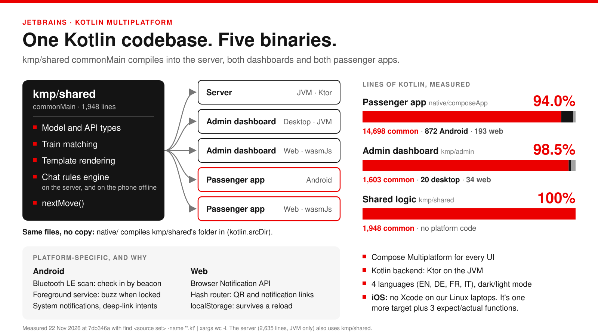
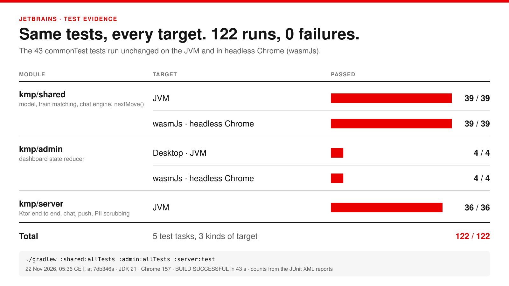

# How the pitch worked

We gave three pitches at LauzHack 2026: to the main jury, to JetBrains and to SBB. **All three were live demos, with no slides.** This page explains how they were put together: the decision behind them, the cast, the script SBB's own data gave us, each pitch scene by scene, and the rules we held ourselves to on stage.

The original working files are in [`pitch/`](pitch/): the three screenplays (`screenplay-*.txt`), the setup notes and the visuals. Times on this page are Lausanne time (CET).

**Contents:** [No slides](#the-decision-no-slides) · [Three pitches](#three-pitches-three-audiences) · [The cast](#the-cast) · [Four beats](#the-script-sbbs-real-evening-in-four-beats) · [SBB pitch](#the-sbb-pitch-scene-by-scene) · [JetBrains pitch](#the-jetbrains-pitch) · [Main pitch](#the-main-pitch) · [Rules](#the-rules-we-pitched-by) · [Stage prep](#preparing-the-stage) · [When it breaks](#when-things-break) · [Q&A](#questions-we-prepared-for) · [Rehearsals](#rehearsals-fed-the-product)

---

## The decision: no slides

On Sunday morning, as team lead, I decided that the JetBrains and SBB presentations would both be **live demos**. Every "deck" turned into speaker notes plus a runbook.

The reasoning was simple. The whole product is one moment: a phone buzzes in a stopped train, and the passenger knows what's going on. A slide can only describe that moment, but a demo makes it happen in front of the judges. A demo that works live is also the strongest evidence that the thing is real.

That gave the SBB pitch an unusual opening. It had no dramatic hook and no "95 minutes" statistic up front, just one sentence:

> *"We took an already existing product and made it even more user friendly."*

SBB's judges know SBB Mobile better than anyone. So the pitch started from the app they know, and let the improvement show itself.

## Three pitches, three audiences

| | Main jury | JetBrains | SBB |
|---|---|---|---|
| **Length** | ~3 min | ~4 min | ~6 min |
| **Who's judging** | Every project, so tell the whole story once | Kotlin Multiplatform: platforms, shared code, native feel, the agentic process | "Turn disruption data into the best next move" |
| **On the projector** | The phone (mirrored) next to the dashboard | Four screens side by side: the Android phone, the same app in a browser, the dashboard on the web and on the desktop | The dashboard. The phones are in the judges' hands |
| **The big moment** | 15 s of silence, then the phone buzzes | One click on Publish, the same update on four screens | Three judges' phones buzz at once; the same update gives three different next moves |
| **The close** | "Passengers waited 95 minutes. Here they knew in 15 seconds." | "SBB: 95 minutes. Us: 15 seconds. One codebase, five binaries." | "The AI does the writing; the people in the control room keep the decisions." |

## The cast

Every pitch had the same four roles:

| Role | Who | Job on stage |
|---|---|---|
| **Presenter** | Albert | All the talking points. In the SBB pitch, standing next to the judges and walking them through their phones |
| **Operator** | Emil | Drives the dashboard on the projector: sends each beat of the replay, opens the publish dialog, publishes, resolves |
| **Phone** | Matej | Holds the mirrored Android phone and types the chat questions. In the SBB pitch, helps a stuck judge and re-checks a phone in |
| **Backup** | Martin | Off to the side, with a recording of a rehearsal ready to play and the headless smoke test ready to run, in case the live server dies |

## The script: SBB's real evening in four beats

SBB gave us the real data from **17 September 2026**: a fire on the overhead line between Renens VD and Allaman. Replaying the evening by the clock doesn't work on stage: at any speed it's either far too long or too fast to follow. So the demo sends **four curated moments** of the real data, one click each, and the presenter sets the pace.

| Beat | What's sent | What happens on stage |
|---|---|---|
| **1. Fire on the line** | 2 messages from SBB's VIA event log: a power failure and an overhead-line fault | An incident opens by itself on the dashboard, "not published", with a countdown. About 15 seconds later, every checked-in phone buzzes with the safety net: "Nothing more is known yet. Next update by HH:MM." |
| **2. Chaos in the control centre** | 7 real messages from the internal KULT ticker, mostly French shorthand: trains turning back, the overhead line down, the fire brigade on site | The AI's draft is already in the publish dialog. The operator checks it and publishes. The phones update with the cause and each passenger's own next move. |
| **3. Buses on the way** | The replacement buses are ordered (14 of them) | A new draft leads with the buses, because passengers asked about them. On the phones, SBB's confirmed advice moves to the top, and our suggestion steps back. |
| **4. Line open again** | The first trains run again | The AI drafts the all-clear, the operator resolves, and the yellow band disappears from every phone. |

At first the beats were sent from a terminal on the server's laptop, one Enter per beat. On Sunday morning Emil built a **"Live demo" bar** into the dashboard, so one operator could drive the whole show from the projector: one button per beat, strictly in order, a double click does nothing, and "Start over" asks before it clears everything.

## The SBB pitch, scene by scene

Three judges each got one of our phones. Each phone was a different passenger on the same train, on the same evening:

| Phone | The passenger | Ticket | Where they are |
|---|---|---|---|
| 1 | Going to Lausanne | Supersaver | On IR 90 1734 |
| 2 | Going on to Sion | Single ticket | On IR 90 1734 |
| 3 | Waiting for IR 90 1734 to Sion | GA travelcard | Still on the platform in Lausanne |

**Scene 1 — Opening, and how your phone knows (0:00–0:55).** The opening line, then the phones go to the judges. They see SBB Mobile as they know it, with today's trip. The presenter points out that we changed only the places where SBB already talks about disruptions: the notification, a yellow band on top of every tab, and the Information page. Then he answers the first question every judge has: *how does it know I'm on this train?* Every car has a Bluetooth beacon that sends its name. While the screen is on, the app listens every ~20 seconds and takes the strongest signal. It sends only the train, the car, the language and the destination. No name, no login. Phone 3 isn't on board yet, so it follows its departure from the platform instead. And, said out loud: *"There's no train in this room, so on stage the beacon is simulated. The scanning code is the real one."*

**Scene 2 — Fire on the line (0:55–1:45).** The operator sends beat 1. Two messages appear on the projector, and an incident opens by itself. Then the presenter stops talking. For about **15 seconds nothing happens**, and then all three phones buzz in the judges' hands. "Unlock your phone. Tap the band." The Information page says what SBB itself would say: nothing more is known yet, and when the next update comes.

> *"Nobody in the control centre has typed anything yet. That's the safety net: if nobody publishes within 15 seconds, the system tells the passengers itself. No AI in this step, just a rule."*

**Scene 3 — The control room's AI (1:45–3:20).** The operator sends beat 2, and the ticker fills with internal French shorthand. *"Passengers can't read that, and the staff have no time to rewrite it."* The operator opens the publish dialog with the draft already filled in, and the presenter walks along it on the projector:

> *"This is the AI's draft. Four things happened before Emil even clicked. One: before anything left our server, we stripped staff names, phone numbers and IDs out of that ticker. The model never sees them. Two: it turned the shorthand into a passenger update, in German, French, Italian and English at once. Three: it read what passengers are already asking in the chat, as topics and counts, never their words. Four: it drafted ahead, so Emil doesn't wait."*

The operator changes one word, to show it's editable, and publishes. The three phones update, and each shows something different. Phone 1 sees "Stay on board for now", a real backup route, the last moment to decide and "Supersaver: you may take another train". Phone 2 gets the same advice, but with a route that goes on to Sion. Phone 3 sees "Wait at the station for now".

> *"Same update, three passengers, three next moves. That advice is not AI: it's computed from SBB's published facts and the real timetable."*

**Scene 4 — The judges ask (3:20–4:20).** Each judge asks the chat something different: "How do I get to Basel?", "Will I make my connection?", "What happened?". The answers take 5–9 seconds, come back in the language the judge wrote in, and use real routes from the Swiss journey planner. Then the operator opens Passenger questions on the projector, and the judges' own questions are there, grouped by topic with a count. *"Three hundred people asking about buses become one line."*

**Scene 5 — Buses on the way (4:20–5:15).** Beat 3. The new draft has seen the judges' questions, so it leads with the buses. On phones 1 and 2, SBB's confirmed buses now come first, tagged "Confirmed by SBB". *"The question you asked a minute ago now has SBB's own answer."* Phone 3 still says to wait at the station, because the buses are for the closed section and its train still comes through Lausanne.

**Scene 6 — Line open again (5:15–5:45).** Beat 4, Resolve. The yellow band disappears from every tab. *"Even the all-clear was drafted from the ticker, and checked by a human."*

**Scene 7 — Close (5:45–6:05).**

> *"On 17 September, the first public travel advice came after 95 minutes, and the bus notice after 160. Here, everyone checked in knew within 15 seconds, and got their own next move with every update. The AI does the writing; the people in the control room keep the decisions."*

The full screenplay, with every stage direction: [`pitch/screenplay-sbb.txt`](pitch/screenplay-sbb.txt). The setup and the per-phone commands: [`pitch/sbb-demo-notes.md`](pitch/sbb-demo-notes.md).

## The JetBrains pitch

The JetBrains brief judged platforms, native feel, what's shared in `commonMain`, innovation, the agentic process and the presentation. So the projector showed **four Compose Multiplatform screens** at once:

1. The passenger app on the Android phone, mirrored with `scrcpy`.
2. The same passenger app in a narrow browser window (WebAssembly).
3. The dashboard in the browser (WebAssembly), with the Live demo bar.
4. The dashboard on the desktop (JVM).

| Scene | What it proves |
|---|---|
| **One codebase** | "An Android app. The same app in the browser. The control room on the web and on the desktop. One Kotlin codebase, five binaries with the Ktor server." |
| **The safety net** | Beat 1: both dashboards show the incident, and both passenger apps show "not known yet". The same model classes on all four screens. |
| **The Koog agent** | Beat 2. The draft is a [Koog](https://docs.koog.ai) agent defined in our shared Kotlin, running on the server. The presenter names its six tools, every one a function we wrote: the ticker events, the affected trains, what's already published, the passenger's next move, the routes around the closure, and what passengers are asking. "So it can only draft from facts our code computes." |
| **One click, four screens** | Publish on the desktop dashboard. Within a second or two: a notification on the phone, the web app updates, and the web dashboard's timeline shows it. |
| **The agent reads the questions** | The phone asks "Is there a bus?". The question shows up grouped in the dashboard. Beat 3, and the next draft answers it. The agent saw a topic and a count, never the passenger's words. |
| **Shared logic in the browser** | New incident → pick Renens VD → Allaman → the affected trains appear instantly. That's the shared `affectedTrains()` compiled to WebAssembly; the server ran the same function on the JVM. |
| **Native feel** | Dark mode on both apps with the same SBB design tokens; four languages, updates included. |
| **What's shared, measured** | The passenger app is 94 % common code and the dashboard 98.5 %. The chat's rules engine was ported from TypeScript and proven against 2,940 golden answers from the old one. Only three `expect` functions are per platform, and the same tests run unchanged on the JVM and as wasm in headless Chrome. |
| **The deterministic core** | "The card a passenger sees is never model output." `nextMove()` is plain arithmetic, and the agent reads that same function as a tool, so the draft never contradicts the card. |
| **Four people, four agents** | The message board, the claims, the lead, and one real six-minute thread: an agent found the chat contradicted the next-move card, fixed it on a branch with tests, the owner's agent reviewed it, and the lead approved. Plus an honest note: "We used Claude Code in the terminal, not JetBrains Air." |

The evidence the team prepared for this track (measured around 05:40 on Sunday, a few hours before the final build, so the numbers differ slightly from the final code):

Screenplay: [`pitch/screenplay-jetbrains.txt`](pitch/screenplay-jetbrains.txt). Setup and fallbacks: [`pitch/jetbrains-demo-notes.md`](pitch/jetbrains-demo-notes.md), [`pitch/jetbrains-live.md`](pitch/jetbrains-live.md).

## The main pitch

The general jury sees every project, so this one told the whole story once, in seven scenes and three minutes, on one mirrored phone next to the dashboard:

1. **The question (0:00–0:25).** "17 September 2026, 17:22. A fire on the overhead line between Renens and Allaman. Thousands of passengers sit in stopped trains with one question: what do I do now?"
2. **The fire (0:25–0:55).** Beat 1, 15 seconds of silence, the buzz. "That's honest, and it's 15 seconds instead of 95 minutes."
3. **From shorthand to a decision (0:55–1:40).** The French ticker, the AI draft, Publish, the passenger's next move.
4. **The chat (1:40–2:05).** "How do I get to Basel?", answered with real times, then grouped on the dashboard.
5. **Over (2:05–2:20).** Resolved.
6. **How it's built (2:20–2:50).** One Kotlin Multiplatform codebase; four people with four AI coding agents on one GitHub issue.
7. **Close (2:50–3:00).** "On 17 September, passengers waited 95 minutes. Here they knew in 15 seconds, and every update told each of them what to do next."

Screenplay: [`pitch/screenplay-main.txt`](pitch/screenplay-main.txt).

## The rules we pitched by

### A "don't claim" list for every pitch

Every screenplay ends with a list of things that would be easy to say on stage and are not quite true. Judges ask follow-up questions, and one overclaim that gets caught costs the credibility of everything else. Some of them:

| Tempting to say | What's actually true |
|---|---|
| "The beacon on stage is real." | It's simulated. The scanning code is real. |
| "It checks you in with the screen off." | Android delivers no unfiltered scan results then; the check-in happens the next time the screen is on. |
| "Real Bluetooth check-in is proven." | We only tested it with the simulated beacon. |
| "It barely uses any battery." | We never measured it. |
| "The chat never makes things up." | It's told never to invent a time. It has no separate fact check. |
| "The advice on Your trip is AI." | It's computed, not generated. |
| "Koog runs on the phone and offline." | It runs on the server and needs the network at every step. |
| "It runs on iOS." | It doesn't. "One more target and three actual functions; no Xcode on our laptops." |
| "We used JetBrains Air." | We used Claude Code in the terminal. |

### Every line checked against the code

The screenplays were rebuilt against a specific commit, and re-cut every time the product changed under them. Two examples:

- **The offline moment that stopped being true.** The JetBrains pitch first had an "airplane mode" moment: the phone, cut off from the server, answered a question from the shared rules engine on the device. At 10:40 on Sunday the chat moved to waiting for a real model and saying "sorry" on a timeout instead of falling back to the rules. That was the honest choice for the product, and it meant the airplane-mode moment no longer happened. So we cut it and replaced it with the question loop: the phone asks, the dashboard groups the question, the agent's sixth tool reads the group, and the next update answers it.
- **"In the background" became "while the screen is on".** The first version of the Bluetooth line said the app listens in the background. A check of the scanner code showed that Android only delivers these scan results while the screen is on, so the line changed, and "checks you in with the screen off" went on the don't-claim list.

The screens quoted in the screenplays are what a real phone showed in rehearsal, not what we expected it to show.

## Preparing the stage

- **The server** ran on Emil's laptop behind a Cloudflare quick tunnel, as self-healing systemd services with a watchdog. The rule was never to stop it, because a new tunnel means a new address and every phone would need re-pointing.
- **Before every run:** `./demo status`; `./demo test --reset --force` must print **9/9** (the headless check of all nine demo steps); "Start over" in the Live demo bar; and the draft engine switched to the right mode for the pitch (`./demo koog on` for JetBrains, the single-call draft for SBB).
- **The phones:** one command per phone, `flash-demo-phone.sh <serial> supersaver|ticket|ga`. It installs the build, clears old data, grants every permission so no dialog pops up on stage, keeps the screen on over USB, checks the phone in as that passenger, and warns if Do Not Disturb is on. Then: unmuted, Do Not Disturb off, screen timeout 10 minutes, locked, face up.
- **Mirroring:** `scrcpy --stay-awake` over USB. It doesn't forward vibration, so the phone holder lifts the phone when it buzzes.

## When things break

Every screenplay has a fallback for each failure, decided in advance so nobody improvises under pressure:

| If… | Then… |
|---|---|
| A phone doesn't buzz | Point at the dashboard ("the control room shows it went out") and carry on; re-check the phone in afterwards |
| The AI draft is slow | The operator publishes the template text instead; the presenter says the AI line anyway |
| The chat says "sorry" | Ask once more. If it fails again, skip to Passenger questions, where the question is still grouped |
| A screen dies (JetBrains) | Point at its twin: every app runs on two platforms |
| The live server is down | The backup plays the rehearsal recording, and the presenter narrates the same scenes |
| We're over time | Cut in a fixed order (the map moment first, then the third judge's question, and so on). Never cut the safety net, the AI walk-through or the close |

## Questions we prepared for

- **"What if two trains are next to each other in the station?"** The app takes the strongest beacon and checks again every 20 seconds, so it settles on the train you're in. If it's still wrong, "Not on this train?" undoes it and pauses automatic check-in for 10 minutes.
- **"What does SBB need to install?"** A beacon per car, or just the QR code that EasyRide cars already have. The rest is software.
- **"What if the AI draft is wrong?"** It's a draft. A human checks and publishes every word. The passenger's advice is computed from the published facts and the real timetable, not written by the AI.
- **"Does the AI see personal data?"** No. Staff names, phone numbers and IDs are removed before the ticker leaves our server, and the draft is checked again on the way out. From the chat, the AI sees topics and counts, never what a passenger typed.
- **"Is this real data?"** The 17 September messages are SBB's own logs, replayed. The alternative routes come live from OJP, the Swiss journey planner.
- **"Does SBB have to replace anything?"** No. We sit between the ticker the control centre already writes and the channels SBB already uses: the app, push, the status page.

## Rehearsals fed the product

Full rehearsals ran on the live server, on our own phones, through Sunday morning. Several of the last changes came straight out of them:

- A rehearsal phone missed an incident because someone had tapped "Not on this train?", which paused automatic check-in **for good**. The pause now lasts at most 10 minutes.
- Disruption alerts respect Do Not Disturb, so "Do Not Disturb off" went into the pre-stage checklist.
- The question "what if the operator edits the draft by hand?" led to the server translating the operator's English edit into the other three languages at publish.
- Running the beats from a terminal was one more thing to get wrong on stage, so the beats moved into the dashboard's Live demo bar.

How the four of us (and our four agents) built all this in about 28 hours: [`HOW-WE-BUILT-IT.md`](HOW-WE-BUILT-IT.md).
